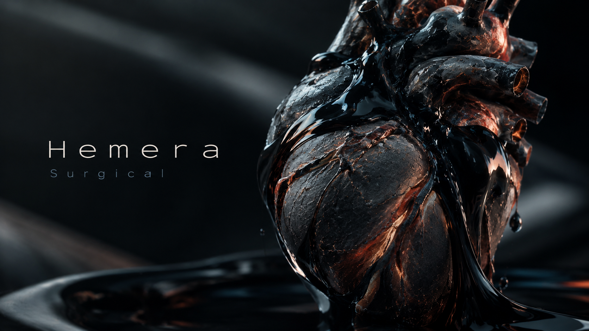
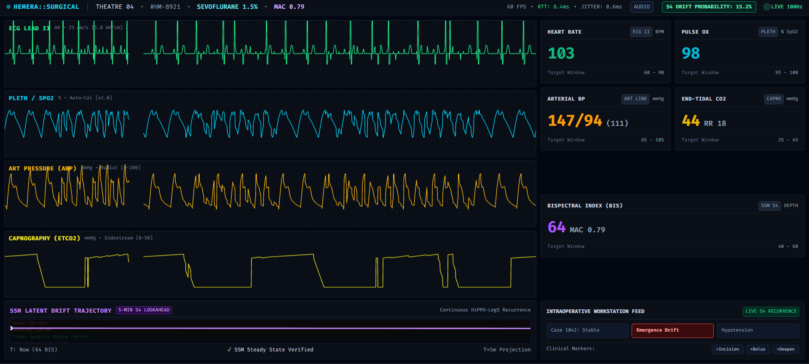
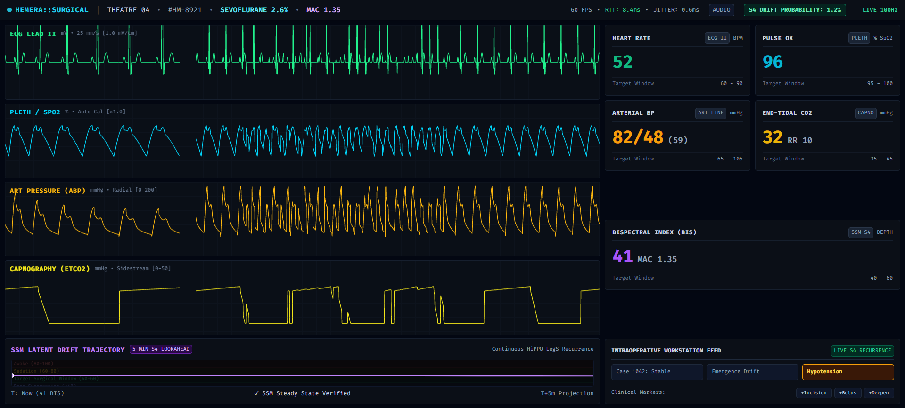

<p align="center">
  
</p>

# Hemera Surgical

> A low-latency surgical telemetry monitor and intraoperative drift copilot built with React, WebGL 2.0, and continuous S4 State-Space Models.

[](LICENSE)
[]()
[]()
[-purple.svg)]()

Traditional operating room monitors are closed, proprietary hardware running outdated interfaces with zero predictive intelligence. Meanwhile, modern deep learning architectures like Transformers cannot handle continuous real-time physiological signals without quadratic memory blowup.

**Hemera** bridges this gap: a modern operating room telemetry workstation capable of ingesting high-frequency vitals at 100 Hz, rendering multi-lead waveforms at 60 FPS with zero garbage collection lag, and predicting anesthetic emergence drift minutes before physical symptoms manifest.

---

## Interface

### Emergence Drift Detection (Critical Alert)
Capturing sympathetic emergence during surgery. As heart rate climbs to 103 BPM and arterial blood pressure spikes, the continuous S4 model flags autonomic instability, forecasting a 5-minute Bispectral Index (BIS) trajectory lookahead.

<p align="center">
  
</p>

### Deep Anesthetic Plane & Hemodynamic Stability
Displaying baseline sinus rhythm and steady drug concentrations (Sevoflurane 2.6%, MAC 1.35). Waveforms dynamically expand to reflect bradycardia (52 BPM) and lowered systemic vascular resistance while keeping S4 drift scores below 2%.

<p align="center">
  
</p>

---

## How It Works


Bedside Sensors / Replay Driver (100 Hz)
│
▼
Python Telemetry Engine (ws://localhost:8765)
├── Phase Accumulator (ECG II, Pleth, Art Line, Capnography)
└── S4 Recurrent Inference (Constant-time HiPPO-LegS cell)
│
▼ (<10ms WebSocket Stream)
React + WebGL 2.0 Workstation (Port 5173)
├── Zero-GC Circular Ring Buffers (Float32Array)
├── WebGL Shader Pipeline (60 FPS phosphor persistence)
└── Web Audio API (IEC 60601-1-8 alarms + SpO2-tracked pulse tones)


### 1. Constant-Time S4 Inference ($O(1)$)
Instead of buffering minutes of waveform history into an attention matrix, Hemera uses a continuous-time State-Space Model discretized through bilinear transforms:

$$h_k = \bar{A}h_{k-1} + \bar{B}u_k, \quad y_k = C h_k + D u_k$$

State updates execute in fixed microseconds per vital packet, providing multi-minute context memory without latency spikes or RAM accumulation over long operations.

### 2. Zero-GC WebGL Rendering
Browser garbage collection pauses ruin real-time medical displays. Hemera uses pre-allocated `Float32Array(2048)` circular ring buffers with bitwise index masking (`index & 2047`). Vertex arrays are written directly via `gl.bufferSubData`, completely avoiding object instantiations during render loops.

### 3. IEC 60601-1-8 Compliant Audio
Synthesizes clinical-grade auditory feedback directly in Web Audio:
* **Plethysmographic tone:** Dynamic pitch scaling tracking oxygen saturation ($f(SpO_2) = 440 \times 2^{\frac{SpO_2 - 90}{10}}\text{ Hz}$).
* **Tier-1 emergency bursts:** Calibrated 5-tone harmonic bursts (C5–E5–G5–F5–A5) with exponential envelope dampening when critical drift is predicted.

---

## Quickstart

### Prerequisites
* **Node.js** 18+
* **Python** 3.10+

### 1. Clone & Setup Environment

git clone [https://github.com/Velocity07/Hemera-Surgical.git](https://github.com/Velocity07/Hemera-Surgical.git)
cd Hemera-Surgical
cp .env.example .env


### 2. Start the Telemetry Service


cd services/webrtc_streamer
python -m venv .venv

# Windows
.venv\Scripts\activate
# Linux/macOS
source .venv/bin/activate

pip install -r requirements.txt
python -m src.signaling


*Service will listen on `ws://0.0.0.0:8765`.*

### 3. Launch the Workstation UI

In a second terminal:


cd apps/copilot_ui
npm install
npm run dev


Open [http://localhost:5173](http://localhost:5173). Click anywhere on the dashboard to unlock browser audio for the pulse oximeter tones.


## Repository Structure


Hemera-Surgical/
├── apps/
│   └── copilot_ui/             # React 18, Vite, TypeScript, TailwindCSS
│       ├── src/
│       │   ├── components/     # WebGL 2.0 canvases & vitals monitors
│       │   ├── hooks/          # Low-latency WebSocket ingest hooks
│       │   ├── store/          # Zustand store for zero-overhead telemetry
│       │   └── utils/          # Web Audio synthesizer (IEC 60601-1-8)
├── services/
│   ├── s4_engine/              # HiPPO-LegS S4 recurrence & drift inference
│   └── webrtc_streamer/        # 100 Hz multi-parameter physiological streamer
│       └── src/signaling.py    # WebSocket server
├── docs/assets/                # UI captures and banner art
└── docker-compose.yml          # Containerized deployment spec


---

## License

Distributed under the MIT License. See [LICENSE](https://www.google.com/search?q=LICENSE) for details.


```
